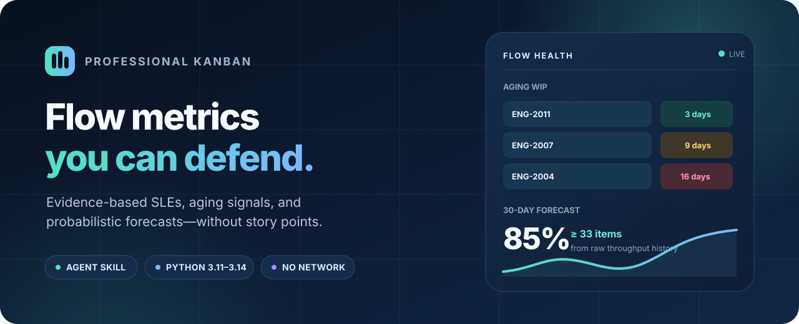

<div align="center">
  
</div>

<h1 align="center">Professional Kanban</h1>

<p align="center">
  <strong>Turn delivery history into honest flow signals, SLEs, and probabilistic forecasts.</strong>
  <br>
  One portable skill for ChatGPT, Claude, Claude Code, and Codex.
</p>

<p align="center">
  <a href="#install-in-30-seconds">Install</a> ·
  <a href="#see-it-in-action">See it in action</a> ·
  <a href="#platform-support">Supported hosts</a> ·
  <a href="CONTRIBUTING.md">Contribute</a>
</p>

<p align="center">
  <sub>Compiled by Liz Rettig, Professional Kanban Trainer (PKT), ProKanban.org.</sub>
</p>

## Why Professional Kanban?

| See risk sooner | Forecast with evidence | Keep the answer honest |
|---|---|---|
| Surface aging work before it becomes late completed work. | Sample your raw throughput history instead of fitting a convenient distribution. | Report a range and probability—never disguise a forecast as a commitment. |

No story points. No average-based promises. No service account, telemetry, or
hosted dependency. The bundled Python tools calculate from your data; the skill
teaches the assistant how to select the right method and explain the result.

## See it in action

> **You ask**
>
> “Here are my completed-items and in-progress CSVs. Which work needs attention
> today, and how many items can we finish in the next 30 days?”
>
> **Professional Kanban answers**
>
> “ENG-2004, ENG-2003, and ENG-2002 are past the 14-day SLE—swarm, split, or
> unblock these first. Based on raw historical throughput, there is an 85% chance
> of completing **32 items or more** in the next 30 calendar days.”

The assistant chooses the calculation, runs it, and returns the decision signal
with its assumptions—not just a number.

## Install in 30 seconds

Find your host, copy what is in its row, and start a new chat or session.

| Where you work | What you install | Do this |
|---|---|---|
| ChatGPT | An uploaded Personal Skill | Download [`professional-kanban.skill`](https://github.com/ProKanban/professional-kanban/releases/latest/download/professional-kanban.skill), then upload it at **Plugins > Skills > Create > Upload from your computer** |
| Claude.ai / Claude Desktop Chat | An uploaded custom skill | Download [`professional-kanban.zip`](https://github.com/ProKanban/professional-kanban/releases/latest/download/professional-kanban.zip), then upload it at **Customize > Skills > + Create skill > Upload a skill** |
| Claude Code / Desktop Code | A plugin, from the `prokanban` marketplace | `/plugin marketplace add ProKanban/professional-kanban`<br>`/plugin install professional-kanban@prokanban`<br>`/reload-plugins` |
| Codex CLI / desktop / IDE | A standalone skill | `gh skill install ProKanban/professional-kanban professional-kanban --agent codex --scope user` |

Every route installs the same skill: the same instructions, references, and
scripts from `skills/professional-kanban/`. Only the packaging differs. Claude
Code calls it a *plugin*, Claude.ai calls it a *custom skill*, and ChatGPT calls it
a *Personal Skill*.

> [!NOTE]
> Professional Kanban is not yet listed in Anthropic's or OpenAI's plugin
> directories, so searching for it inside Claude, ChatGPT, or Codex will not find
> it yet. Use the route for your host above.

### ChatGPT

You install an **uploaded Personal Skill**. Download
[`professional-kanban.skill`](https://github.com/ProKanban/professional-kanban/releases/latest/download/professional-kanban.skill)
from the [latest release](https://github.com/ProKanban/professional-kanban/releases/latest),
open **Plugins > Skills > Create > Upload from your computer**, upload it, and start
a new chat.

Personal Skills are currently available on eligible Business, Enterprise,
Healthcare, and Edu accounts; workspace admins can control uploads. A Personal
Skill installed on desktop does not automatically sync to web/mobile, so upload it
on each surface where you need it. See OpenAI's
[current Skills guide](https://help.openai.com/en/articles/20001066).

### Claude.ai / Claude Desktop

You install an **uploaded custom skill**. Download
[`professional-kanban.zip`](https://github.com/ProKanban/professional-kanban/releases/latest/download/professional-kanban.zip)
from the [latest release](https://github.com/ProKanban/professional-kanban/releases/latest),
enable code execution, open **Customize > Skills**, choose **+ Create skill >
Upload a skill**, upload the ZIP, and start a new chat.

The same custom skill is available in Claude.ai and the Chat tab of Claude Desktop.
Team and Enterprise owners can provision the ZIP organization-wide. See Anthropic's
[current Skills guide](https://support.claude.com/en/articles/12512180-use-skills-in-claude).

### Claude Code

You install a **plugin** named `professional-kanban` from a marketplace named
`prokanban`. For automatic marketplace updates, run these commands inside Claude
Code:

```text
/plugin marketplace add ProKanban/professional-kanban
/plugin install professional-kanban@prokanban
/reload-plugins
```

The skill activates on its own when you ask a delivery question. To call it
explicitly, use `/professional-kanban:professional-kanban`. That is not a typo:
Claude Code names a plugin's skills `plugin:skill`, and both the plugin and its one
skill are called `professional-kanban`.

Or install the standalone skill at user scope with GitHub CLI (preview), without
the plugin:

```bash
gh skill install ProKanban/professional-kanban professional-kanban \
  --agent claude-code --scope user
```

### Codex

You install a **standalone skill**. Install it at user scope with GitHub CLI
(preview):

```bash
gh skill install ProKanban/professional-kanban professional-kanban \
  --agent codex --scope user
```

You can also ask `$skill-installer` in Codex to install
`ProKanban/professional-kanban`. Both commands install the latest release; append
`@vX.Y.Z` to the skill name only if you need to pin a version.

> [!NOTE]
> `gh skill` is a GitHub CLI preview and may change. It needs a current,
> authenticated GitHub CLI. The ZIP/`.skill` upload and Claude marketplace routes
> are independent.

### Verify a download

Each release publishes a `SHA256SUMS` file alongside `professional-kanban.skill`
and `professional-kanban.zip`. Download it into the same folder as the package and
check before you upload:

```bash
shasum -a 256 -c --ignore-missing SHA256SUMS
```

## Platform support

| Host | Best installation | Automatic activation | Bundled calculations |
|---|---|:---:|:---:|
| ChatGPT web/desktop | Upload `.skill` | Yes | Skills/code execution required |
| Claude.ai / Claude Desktop Chat | Upload `.zip` | Yes | Code execution required |
| Claude Code / Desktop Code | Claude plugin marketplace | Yes, or `/professional-kanban:professional-kanban` | Local Python |
| Codex CLI / desktop / IDE | `gh skill install` or `$skill-installer` | Yes, or `$professional-kanban` | Local Python |
| Agent Skills-compatible hosts | Install `skills/professional-kanban/` | Host-dependent | Python execution required |

The skill follows the open [Agent Skills specification](https://agentskills.io/)
and includes separate OpenAI and Claude plugin manifests. One canonical skill
directory powers every package—platform distributions do not fork the
instructions or calculations.

## What it does

| Your question | Method | Decision signal |
|---|---|---|
| “Which work needs attention?” | Aging WIP against the SLE | Items to swarm, split, or unblock |
| “What is our SLE?” | Cycle-time percentiles | A defensible service-level expectation |
| “How much can we finish?” | Monte Carlo on throughput | Items at each confidence level |
| “When might this scope finish?” | Monte Carlo on throughput | Dates at each confidence level |

The calculation layer also:

- Preserves zero-throughput periods and samples raw history.
- Detects common Jira, Azure DevOps, Trello, GitHub, and spreadsheet columns.
- Supports scope growth when the backlog is likely to expand during delivery.
- Rejects ambiguous dates, invalid confidence levels, incomplete simulations, and
  inputs that cannot support the requested analysis.

## Use it

Attach completed-item data and ask naturally:

- “Which in-progress items need attention today?”
- “What is our 85th-percentile SLE?”
- “How many items can we finish in the next 30 days?”
- “When are these 50 remaining items likely to finish?”
- “Our backlog usually grows 25% during delivery. Include that in the forecast.”

The assistant selects and runs the bundled calculation. For direct CLI use,
**Python 3.11–3.14** is supported and no third-party package is required:

```bash
SKILL_DIR="skills/professional-kanban"

python3 "$SKILL_DIR/scripts/monte_carlo.py" how-many \
  --input done.csv --days 30 --start 2026-08-19 --seed 42
python3 "$SKILL_DIR/scripts/monte_carlo.py" how-many \
  --input weekly.csv --weeks 6
python3 "$SKILL_DIR/scripts/monte_carlo.py" when \
  --input done.csv --items 50 --split 1.25 --seed 42

python3 "$SKILL_DIR/scripts/cycle_time.py" sle --input done.csv
python3 "$SKILL_DIR/scripts/cycle_time.py" aging \
  --input done.csv --wip in-progress.csv --as-of 2026-08-19
```

Use `--help` on either script for the complete, command-specific flag list. Example
files live in `skills/professional-kanban/assets/`.

## How it works

`CSV / TSV` → `Validated flow history` → `Cycle time or Monte Carlo` → `Probability + action`

1. The parser recognizes common export columns and validates dates, counts, and
   confidence levels.
2. The assistant routes one-item questions to cycle-time percentiles and many-item
   questions to Monte Carlo on throughput.
3. The scripts produce deterministic results when a seed is supplied.
4. The skill turns the output into plain language while preserving assumptions,
   uncertainty, and the selected Definition of Workflow.

## Your data

The scripts read CSV or TSV with a header row. Extra columns are ignored.

| Shape | Required columns | Supports |
|---|---|---|
| One row per finished item | Completion date; start date optional | Throughput forecasts; cycle time when start exists |
| One row per period | Period/date plus count | Throughput forecasts |
| One row per item | Positive finite cycle time | SLE and right-sizing |
| One row per WIP item | Start date; item/state optional | Aging analysis |

ISO dates such as `2026-08-19` are the safest choice. Ambiguous numeric dates such
as `04/05/2026` are rejected until you choose `--date-order mdy` or
`--date-order dmy`. CLI dates (`--from`, `--to`, `--start`, `--by`, `--as-of`) are
strict `YYYY-MM-DD`.

> [!WARNING]
> **`Created` is almost never your started point.** An item can sit in a backlog
> for months. Measuring from creation can radically overstate cycle time. The
> selected start and finish points must match the team's Definition of Workflow.

See [data preparation](skills/professional-kanban/references/data-prep.md) for
accepted aliases, export notes, historical-window guidance, and thin-data options.

## Privacy and security

The repository contains no MCP server, hosted service, analytics, telemetry,
credential handling, or runtime package installer. **No network requests** are
made by the bundled scripts. They read only the CSV paths you provide, print
results to standard output, and never mutate the input files.

Your host still controls where attachments and model conversations are processed.
Review ChatGPT or Claude workspace data controls before using sensitive delivery
data. As with any externally downloaded skill, inspect the release and verify its
checksum before installing it.

## Update or uninstall

For Claude Code marketplace installs:

```text
/plugin marketplace update prokanban
/plugin uninstall professional-kanban@prokanban
```

For standalone `gh skill` installs, run `gh skill update professional-kanban`.
Pinned installs intentionally stay on their pinned version; reinstall with a newer
tag to upgrade. To remove a standalone skill, delete its `professional-kanban/`
directory from the host's user or project skills folder. ChatGPT and Claude upload
installs can be disabled, replaced, or deleted from their Skills settings.

## Troubleshooting

<details>
<summary><strong>The skill does not activate</strong></summary>

Start a new chat/session after installing. Mention the skill explicitly with
`@Professional Kanban`, `$professional-kanban`, or
`/professional-kanban:professional-kanban`, depending on the host. Check that code
execution/Skills are enabled by the workspace admin.

</details>

<details>
<summary><strong>The CSV reports an ambiguous date</strong></summary>

Prefer ISO dates, or rerun with `--date-order mdy` / `--date-order dmy` after
confirming the source convention.

</details>

<details>
<summary><strong>A column is not detected</strong></summary>

Compare its header with the aliases in
[data preparation](skills/professional-kanban/references/data-prep.md). Open a
parser issue with a redacted header row and five representative rows.

</details>

<details>
<summary><strong>A weekly forecast rejects <code>--days</code> or <code>--by</code></strong></summary>

Weekly counts only justify whole weekly periods. Use `--weeks N`; do not prorate a
weekly observation into assumed daily values.

</details>

<details>
<summary><strong>The evidence is thin or simulations cannot complete</strong></summary>

This is a data/scope finding, not an internal error. Use a representative recent
history, confirm that some periods have positive throughput, and reduce or split
the scope before rerunning.

</details>

<details>
<summary><strong>Claude says <code>/plugin</code> is unknown</strong></summary>

Upgrade Claude Code, restart it, and retry. You can always use the direct ZIP or
standalone skill route instead.

</details>

## Contributing

Parser samples, adversarial edge cases, and documentation corrections are welcome.
Read [CONTRIBUTING.md](CONTRIBUTING.md) before opening a pull request. Security
reports belong in [SECURITY.md](SECURITY.md), not a public issue.

## Sources and license

The instructional material is grounded in the May 2025 *Kanban Guide* and the
ProKanban.org pocket guides. Exact authors, URLs, known licenses, and the boundary
between quoted/derived and original material are recorded in
[THIRD_PARTY_NOTICES.md](THIRD_PARTY_NOTICES.md).

- Scripts, tests, and packaging automation: MIT
- Skill instructions, references, and repository documentation: CC BY-SA 4.0
- Synthetic sample data: CC0-1.0

See [LICENSE](LICENSE), the complete texts in `LICENSES/`, and machine-readable
path mappings in `REUSE.toml`. These licenses grant copyright permissions only;
they do not grant rights in the ProKanban.org name, logo, or PKT certification
marks.
